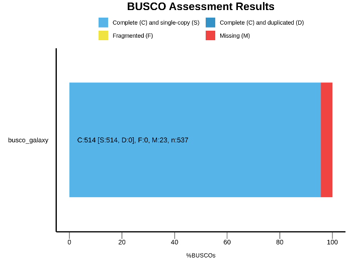
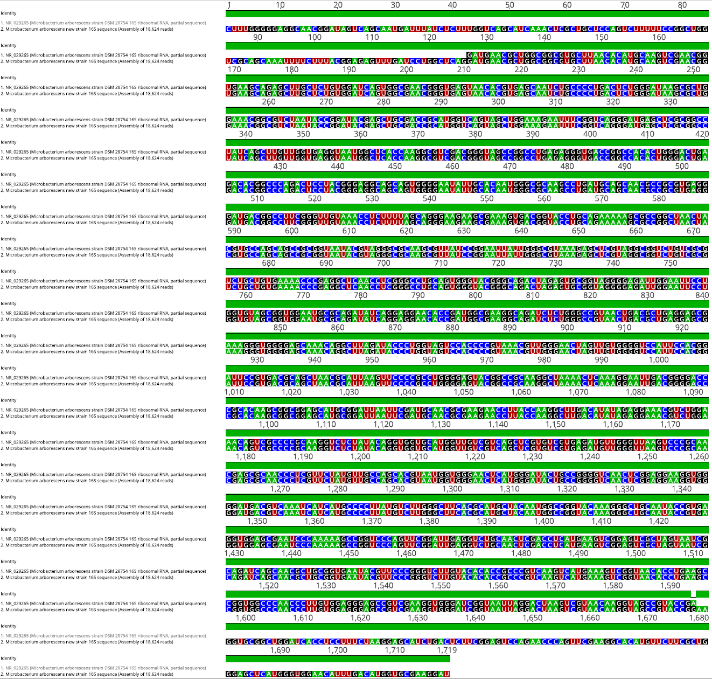
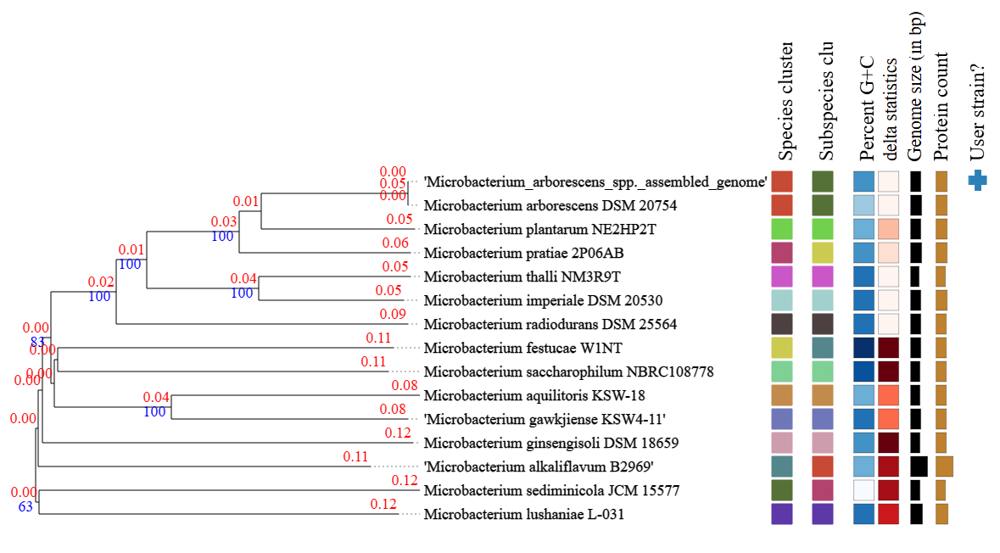
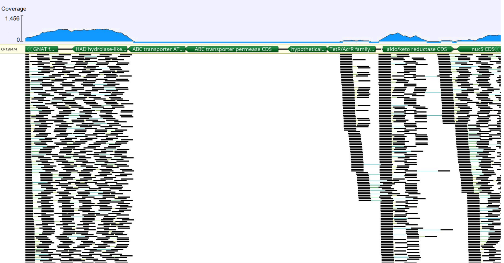
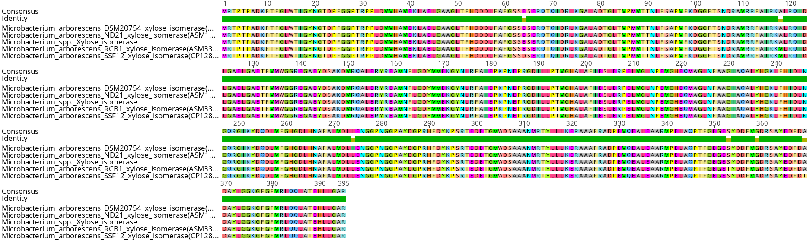
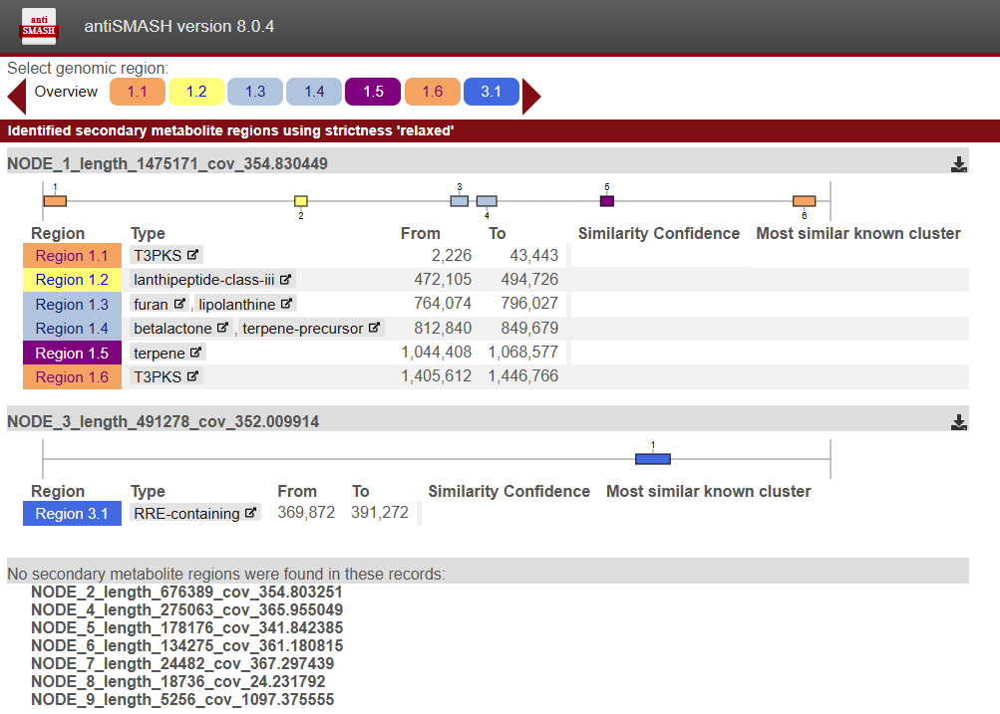

# Whole-genome analysis of a *Microbacterium arborescens* strain

A short-read bacterial genome project, from raw reads to a regulatory-style safety assessment. It is an independent project I developed, intended for submission to the European Food Safety Authority (EFSA), and I keep the scripts, results and a write-up of the work here as a portfolio.

The strain is a *Microbacterium arborescens* isolate (strain not disclosed). The enzyme of interest is xylose isomerase. The files are only the analysis I produced.

## The story

**May 2025: first analysis.** I started from Illumina paired-end reads of a *Microbacterium arborescens* strain and set out to describe the genome following the European Food Safety Authority (EFSA) guidance for whole-genome sequencing (WGS) of microorganisms used in the food chain.
- I assembled the genome with SPAdes, annotated it with Bakta, and checked completeness with BUSCO.
- I identified the species using 16S rRNA alignments.
- I also located and characterised the gene of the enzyme of interest (alignments of nucleotide and protein sequences).
- I wrote a report with the results.

**October to November 2026: regulator follow-up.** The 2024 EFSA statement asked for more evidence, so I extended the work. Everything was run as LSF batch jobs on my institute HPC server.

| Question | What I did | Folder |
|---|---|---|
| Is there antimicrobial resistance or virulence? | ABRicate with the NCBI, CARD, ARG-ANNOT, ResFinder and VFDB databases. First at the usual thresholds, then at the lowest coverage setting (`--mincov 1`) so that nothing was missed, and on the removed contigs too. | `abricate_raw_outputs`, `abricate_lowcov`, `abricate_removed_contigs` |
| Is an *arr*-like gene real or an annotation artefact? | tblastx against *arr* reference sequences, plus a look at the neighbouring genes. | `arr_blast` |
| Does the genome contain toxin or antibiotic clusters? | antiSMASH 8 (MIBiG 3.1 and 4.0). A tblastn of the microvionin gene cluster was also done. | `antismash_out`, `blast_microvionin` |
| Are the reads contaminated? | Kraken2 (Standard-8 database) on the raw reads. | `kraken2_results` |
| Why is it not a closed genome? Why were contigs removed? | Re-ran SPAdes to recover the contigs that the filter had removed (261 of them). Mapped the reads back with Bowtie2 and measured depth at the contig ends. Identified a very high-coverage 155 bp contig as an rRNA operon fragment by BLAST (`Blast_short_contig`). | `bowtie2_tests`, `bowtie2_tests_DSM20754`, `contig_ends`, `Blast_short_contig` |
| Which species and strain is it? | TYGS: digital DNA-DNA hybridisation (dDDH) against type strains, with a whole-genome tree. | `TYGS_results` |

The results are concluded and the analysis was carried through to the end of the requirements. The full write-up (all tables, figures and methods) is in [`Bioinformatics_analysis_report_Microbacterium_arborescens.docx`](Bioinformatics_analysis_report_Microbacterium_arborescens.docx).

## Snapshots from the report

**Assembly completeness: BUSCO.** The short-read assembly (9 contigs) is 95.7% complete.

**Species identification: 16S rRNA.** Full-length 16S alignment of the assembly against the type strain, with the identity graph on top.

**Species identification: whole genome.** TYGS whole-genome phylogeny (GBDP) of the assembly and 14 type strains. The assembly clusters with *M. arborescens* DSM 20754.

**Why the assembly is not a closed genome.** Reads mapped to a reference genome (Geneious): coverage drops to zero across a repeat, where short reads cannot bridge the gap. This is why I describe the assembly as a draft and not as a chromosome-level genome.

**Gene of interest.** Alignment of the xylose isomerase protein of the sequenced strain with published proteins from closely related strains.

**Genes and clusters of concern: antiSMASH 8.** Overview of the seven biosynthetic gene cluster regions found, checked one by one against MIBiG (known toxin and antibiotic clusters).

## What I did in practice

I owned the analysis from raw reads to the final scientific conclusions.

- **Requirements:** I read the EFSA guidance on WGS of microorganisms used in the food chain and turned it into a checklist of what the analysis had to show. When EFSA published newer guidance in 2024 and 2025, I compared it against the work and ran the additional analyses that were actually required, without adding unnecessary ones.
- **Pipeline design:** I designed the overall analysis pipeline: assembly, annotation, species identification, gene of interest, antimicrobial resistance and virulence, biosynthetic gene clusters, read contamination, and assembly completeness.
- **Execution:** I ran every step myself as batch jobs on my institute HPC server (bash, Python, conda environments, LSF), and troubleshot the problems along the way: illegal-instruction crashes, memory limits, and tool and Python version conflicts.
- **Manual verification:** I did not rely on tool output alone. I checked the 16S and protein alignments by eye, inspected the gene predictions, looked at the read mapping at the contig ends, and followed up unclear hits (for example, an *arr*-like gene and a very high-coverage short contig) with extra BLAST searches.
- **Thresholds and interpretation:** I chose and justified the thresholds (for example ABRicate at the lowest coverage setting), separated true hits from fragments, and wrote down what each result means.
- **Report:** I wrote the full report for non-bioinformaticians, with tables, figures and methods, and revised it as questions came up, until it was complete.

## Layout
- `*.sh`, `*.py`: job scripts (`run_*.sh` for the main runs, `build_mibig31_db.py` for a custom antiSMASH database).
- `*.fasta`, `*.fna`, `*.gb`, `*.gff3`: assembly, annotation, and sequence alignments.
- Result folders as in the table above, each with the raw output, the job script and the log.
- Not included because of size: raw reads, BAM files, the Kraken2 database and the SPAdes working folder.

## Tools
SPAdes 3.15.3, Bakta 1.9.4, BUSCO, Kraken2 2.1.2, Bowtie2 2.5.1, SAMtools 1.21, BLAST+ 2.15, ABRicate 1.0.1, antiSMASH 8.0.4, TYGS/GGDC (web), Geneious (alignments), Python and bash.
